# 3.3.2 Builder

[Understanding Builder Patterns from Scratch | Low Level Design | OOPS | Design Pattern | Java](<https://www.youtube.com/watch?v=PSYp5svfxEQ&pp=0gcJCU8JAYcqIYzv>)

[Builder Pattern Makes THIS Problem Vanish – Here's How | Paras Saini](<https://www.youtube.com/watch?v=jcDuCnIsE4g>)

| Builder Design Pattern | [Builder Design Pattern \| Important Java interview question](<https://www.youtube.com/watch?v=w--rhZfxd1w>) | [System Design - LLD - Builder Pattern](<https://www.youtube.com/watch?v=WKiYldof5es>) | [Builder Design Pattern \| Chapter 10: Low Level Design](<https://www.youtube.com/watch?v=W4Ndczy9a8s>) | [🔥Builder Design Pattern in Hindi \| Design Pattern Series](<https://www.youtube.com/watch?v=7x8iQUv5lcM>) | [LLD 05-How Amazon & PhonePe Simplify Orders and Payments Using Builder Pattern \| LLD #codingintelugu](<https://www.youtube.com/watch?v=MqJ8QxrVtdI>) | [23. Builder Design Pattern with Examples, LLD \| Low Level Design Interview Question \| System Design](<https://www.youtube.com/watch?v=qOLRxN5eVC0>) | [How does Builder Design Pattern solves problems like URL creation?](<https://www.youtube.com/watch?v=4ff_KZdvJn8>) | [Builder Pattern - Design Patterns \| Object Oriented Design \| OOPs \| Jav](<https://www.youtube.com/watch?v=6Wi2XZeAf-Q>)a | [Understanding Builder Patterns from Scratch \| Low Level Design \| OOPS \| Design Pattern \| Java](<https://www.youtube.com/watch?v=PSYp5svfxEQ>) | [Builder Design Pattern explained in Detail with Code, Real Life Examples and Applications!](<https://www.youtube.com/watch?v=MrrrtQT_8SE>) |
| --- | --- | --- | --- | --- | --- | --- | --- | --- | --- | --- |

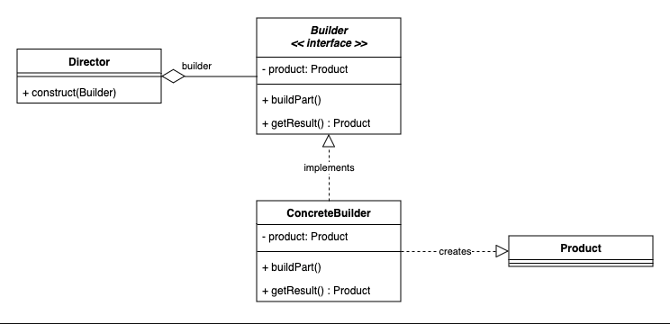

[Builder Design Pattern | Chapter 10: Low Level Design](<https://www.youtube.com/watch?v=W4Ndczy9a8s&list=PLaf8p8Hkzb_F2VUVsYnQUGzGQBrdYtuMr&index=7&pp=iAQB>)

[Builder Pattern | Creational Design Pattern | Intent, Examples, UML Diagrams, Code & Trade-Offs](<https://www.youtube.com/watch?v=Zo8WQN5XrGw&list=PLpVAqPqryuRuiGSz7U7rbYvouCDoM5z_4&index=12&pp=iAQB>)

[Builder Design Pattern in Java ](<https://www.youtube.com/watch?v=j-U1xJ_PaDs&list=PLpxM6m39X_t-Rk9lZVVD4U6JycAAIIEDW&index=7&pp=iAQB>)[🔨](<https://www.youtube.com/watch?v=j-U1xJ_PaDs&list=PLpxM6m39X_t-Rk9lZVVD4U6JycAAIIEDW&index=7&pp=iAQB>)[ | Create Flexible & Scalable Objects | Step-by-Step Guide with Code](<https://www.youtube.com/watch?v=j-U1xJ_PaDs&list=PLpxM6m39X_t-Rk9lZVVD4U6JycAAIIEDW&index=7&pp=iAQB>)

Creational Design Pattern

Building things like a very **complex object**with a **lot of configurations in it**. Then we use the builder design pattern.

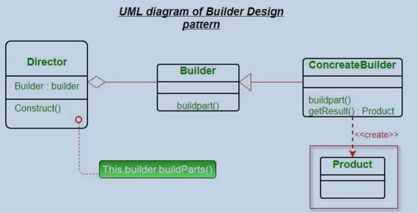

Product = Desktop

Builder = Desktop Builder

ConcreteBuilder = Dell Desktop Builder, HP Desktop builder

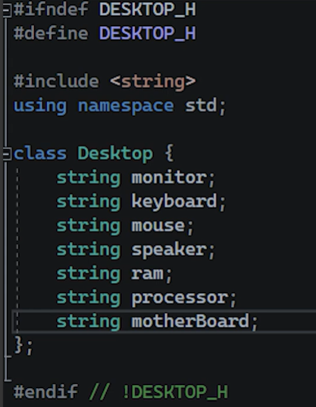

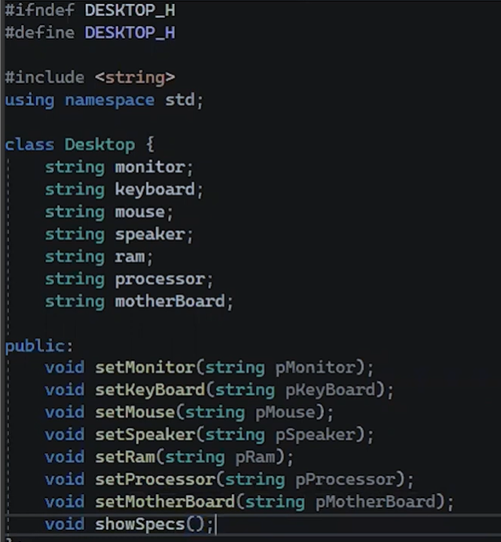

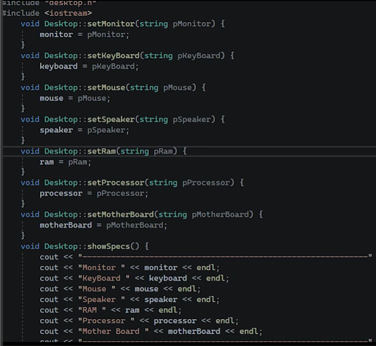

DESKTOPBUILDER.h

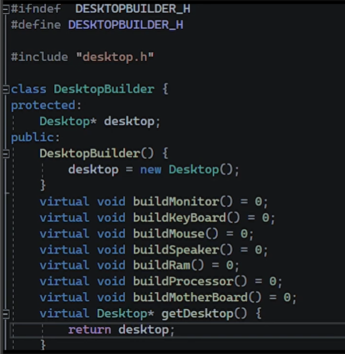

CONCRETE BUILDER

delldesktopbuilder.h

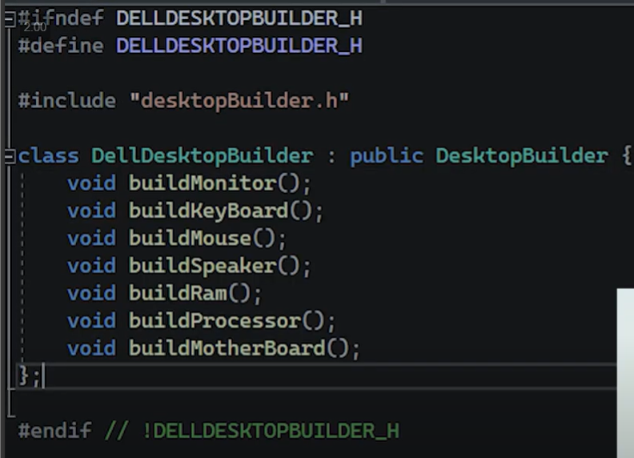

cpp file

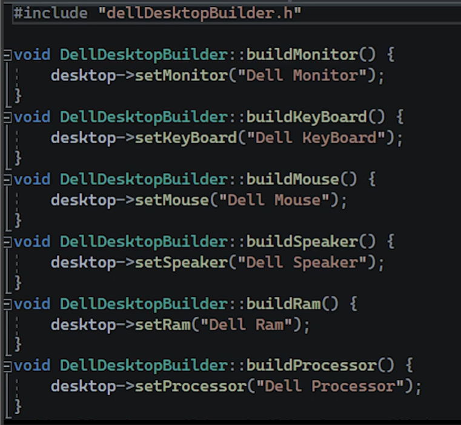

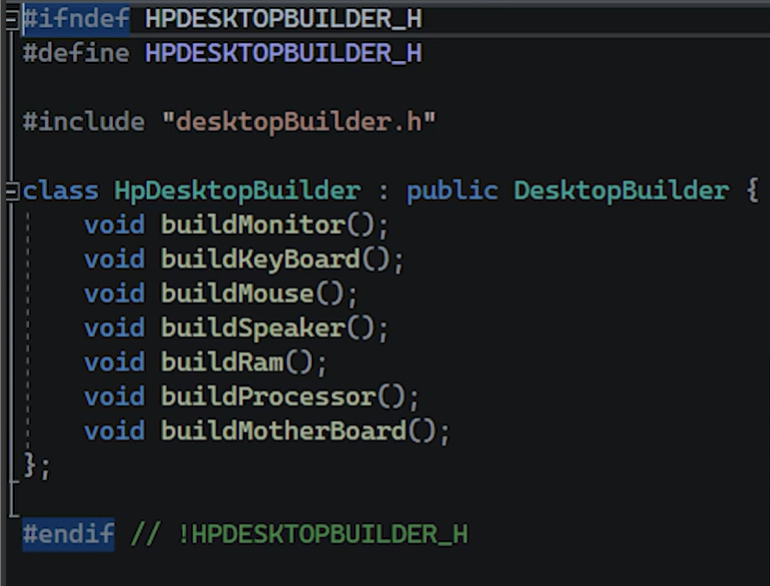

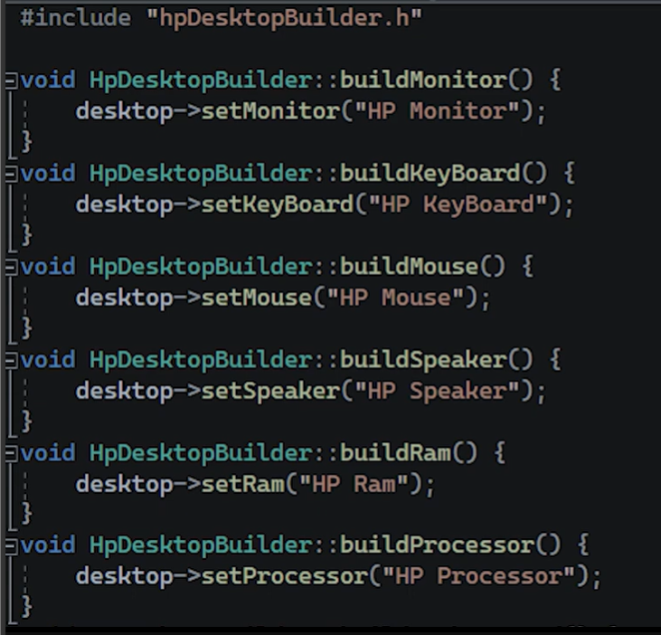

DIRECTOR:

In builder there was product, and in director there will be builder. And the director will use the builder to build the product.

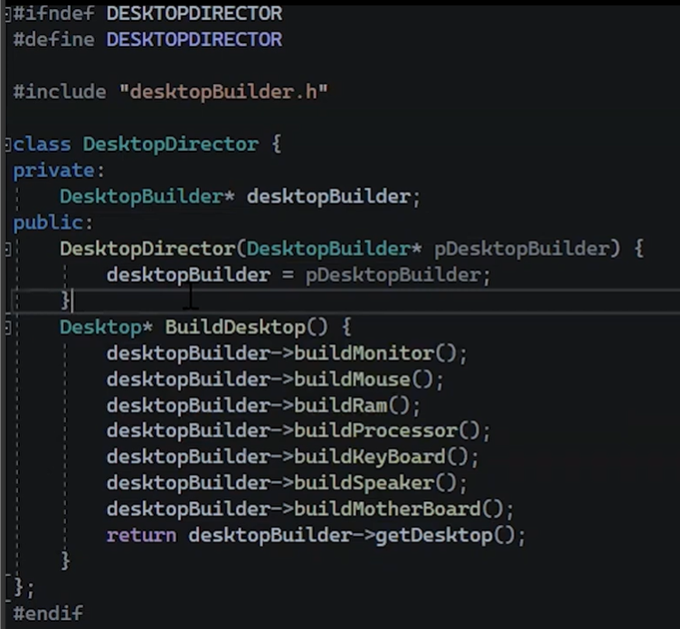

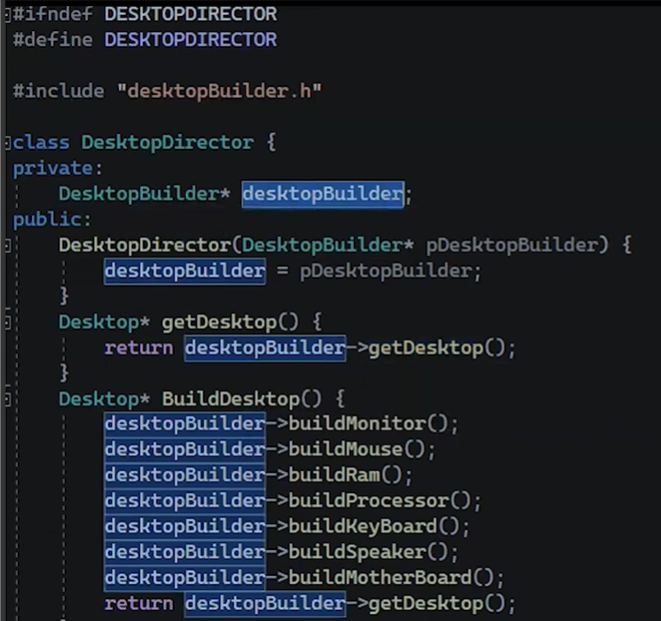

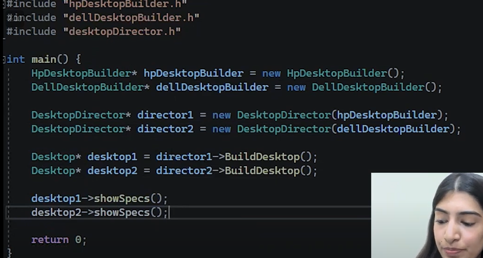

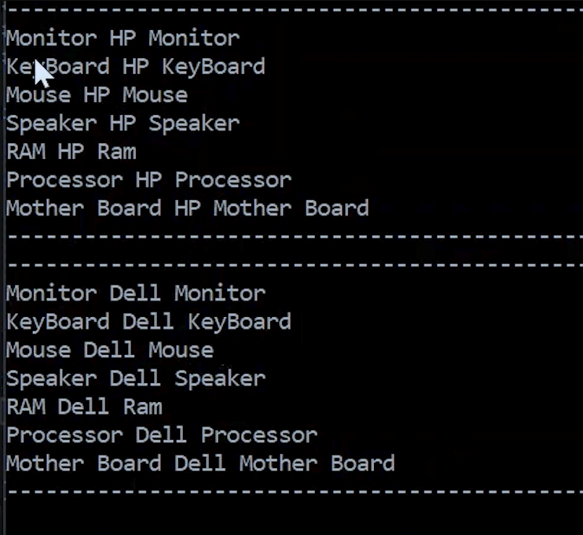
