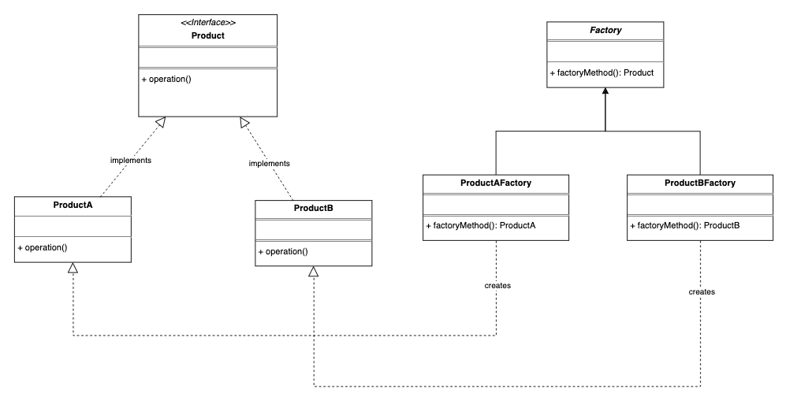
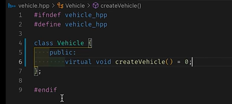
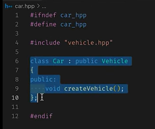
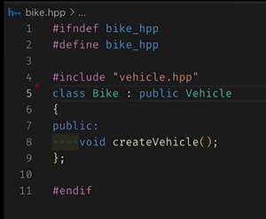
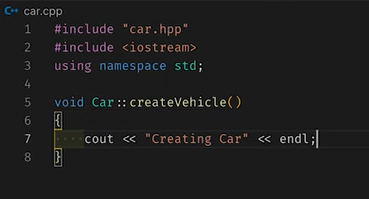
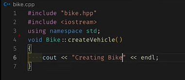

# 3.3.3 Factory

| Factory Design Pattern | [Factory and Abstract Factory Design Pattern \| Important Java Interview question](<https://www.youtube.com/watch?v=NB9_Z-2IiV8>) | [System Design - LLD - Factory Method Pattern](<https://www.youtube.com/watch?v=DVAVVYFERN4>) | [Factory Design Pattern \| Chapter 8: Low Level Design](<https://www.youtube.com/watch?v=Xhzs4TtGlEs>) | [🔥Lets understand Factory Design Pattern in Hindi](<https://www.youtube.com/watch?v=YIB3u0KYrUI>) | [LLD 06-Factory Design Pattern in Java with Real-Life Examples \| HDFC, Netflix, PhonePe #coding](<https://www.youtube.com/watch?v=VEcXL_3ocOY>) | [5. Factory Pattern Vs Abstract Factory Pattern Explanation, Low Level System Design interview](<https://www.youtube.com/watch?v=7g9S371qzwM>) | [How to use Factory Method Design Pattern to design a course website like Udacity, Edx, Coursera...](<https://www.youtube.com/watch?v=s3Wr5_tsODs>) | [Design Pattern - Simple Factory \| Object Oriented Design Patterns \| Factory Pattern \| Systems Design](<https://www.youtube.com/watch?v=lzDq8XOsaQI>) | [Factory Design Pattern - Why and How with Code!!](<https://www.youtube.com/watch?v=tv54FY48Vio>) | [Factory Method Pattern – Design Patterns (ep 4)](<https://www.youtube.com/watch?v=EcFVTgRHJLM>) |
| --- | --- | --- | --- | --- | --- | --- | --- | --- | --- | --- |

[Factory Design Pattern in Java ](<https://www.youtube.com/watch?v=qP-0MQOSxrc&list=PLpxM6m39X_t-Rk9lZVVD4U6JycAAIIEDW&index=5&pp=iAQB>)[🏭](<https://www.youtube.com/watch?v=qP-0MQOSxrc&list=PLpxM6m39X_t-Rk9lZVVD4U6JycAAIIEDW&index=5&pp=iAQB>)[ | Simplify Object Creation with a Centralized Factory Method](<https://www.youtube.com/watch?v=qP-0MQOSxrc&list=PLpxM6m39X_t-Rk9lZVVD4U6JycAAIIEDW&index=5&pp=iAQB>)[🚀](<https://www.youtube.com/watch?v=qP-0MQOSxrc&list=PLpxM6m39X_t-Rk9lZVVD4U6JycAAIIEDW&index=5&pp=iAQB>)

[Factory Design Pattern | LLD Series | Low-Level Design with Code & Class Diagram Car & Bike factory](<https://www.youtube.com/watch?v=yxe9j0VBvqA>)

[Factory Design Pattern | Chapter 8: Low Level Design](<https://www.youtube.com/watch?v=Xhzs4TtGlEs&list=PLaf8p8Hkzb_F2VUVsYnQUGzGQBrdYtuMr&index=10&pp=iAQB>)

[Factory Method Pattern | Creational Design Pattern | Intent, Examples, UML, Code & Trade-Offs](<https://www.youtube.com/watch?v=XsocyfPdbvU&list=PLpVAqPqryuRuiGSz7U7rbYvouCDoM5z_4&index=10&pp=iAQB>)

|  |  |
| --- | --- |
|  |  |

[Use Cases which can be efficiently solved with Factory Design Pattern in Low Level Design Interviews](<https://www.youtube.com/watch?v=jstNvc3d69s>)

[Still Confused About Factory Design Pattern? Watch This Implementation - Paras Saini](<https://www.youtube.com/watch?v=FJVZIdXiIOo>)

[Factory Design Pattern Solved Real Problem – Paras Saini](<https://www.youtube.com/watch?v=DCj-fy-njE0>)
