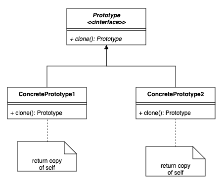
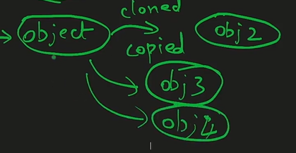
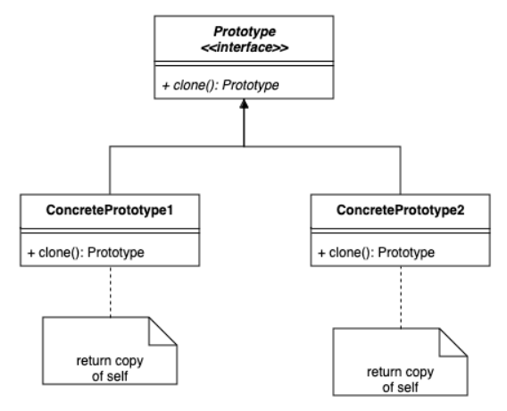
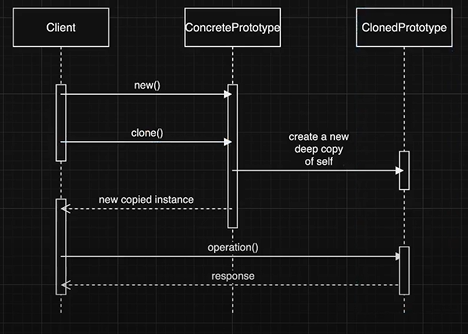

# 3.3.5 Prototype

| Prototype Design Pattern |  | [🔥Prototype Design Pattern in Hindi \| Design Pattern Series](<https://www.youtube.com/watch?v=rriiXRdc0HQ>) | [LLD 07-Prototype Design Pattern in Java with Deep Copy & Registry \| Amazon Prime Example #coding](<https://www.youtube.com/watch?v=rUoIWaLkuDA>) | [Singleton and Prototype Design Patterns \| Systems Design \| Object oriented Design Patterns](<https://www.youtube.com/watch?v=P4losX0HxwE>) |
| --- | --- | --- | --- | --- |

[Prototype Pattern Code: You Won’t Believe How Easy This Is! - Paras Saini](<https://www.youtube.com/watch?v=whq0Q5c0PdQ>)

[The Prototype Pattern: What Most Developers Don’t Know! - Paras Saini](<https://www.youtube.com/watch?v=FI-45tt5pE4&pp=0gcJCSIKAYcqIYzv>)

[Prototype Design Pattern \| Low level design basic to advance series for beginners \| Easily explained](<https://www.youtube.com/watch?v=FXjWwQt_KTE&pp=0gcJCX4JAYcqIYzv>)

[Prototype Design Pattern \| Chapter 11: Low Level Design](<https://www.youtube.com/watch?v=N3EmCgWFpuY&list=PLaf8p8Hkzb_F2VUVsYnQUGzGQBrdYtuMr&index=6&pp=iAQB>)

[Prototype Pattern \| Creational Design Pattern \| Intent, Examples, UML Diagrams, Code & Trade-Offs](<https://www.youtube.com/watch?v=d1_R2L4GBU8&list=PLpVAqPqryuRuiGSz7U7rbYvouCDoM5z_4&index=13&pp=iAQB>)

[Prototype Design Pattern in Java ](<https://www.youtube.com/watch?v=ECPEWMIvRKQ&list=PLpxM6m39X_t-Rk9lZVVD4U6JycAAIIEDW&index=9&pp=iAQB>)[🎭](<https://www.youtube.com/watch?v=ECPEWMIvRKQ&list=PLpxM6m39X_t-Rk9lZVVD4U6JycAAIIEDW&index=9&pp=iAQB>)[ | Efficient Object Cloning Explained | Shallow vs Deep Copy  ](<https://www.youtube.com/watch?v=ECPEWMIvRKQ&list=PLpxM6m39X_t-Rk9lZVVD4U6JycAAIIEDW&index=9&pp=iAQB>)[🚀](<https://www.youtube.com/watch?v=ECPEWMIvRKQ&list=PLpxM6m39X_t-Rk9lZVVD4U6JycAAIIEDW&index=9&pp=iAQB>)

OBJECT CREATIONAL

Problems without using Protype :-

1) Private variables data can't be cloned.

2) Cloned object need to know all field values that has to be cloned.

Deep copy (and not shallow copy)

**Code (Without Using Prototype Pattern)**

**Employee.java**

package com.dev.java.PrototypeDesignPattern;

public class Employee {

private int id;
    String empName;
    String empAddress;
    String empSalary;

public Employee() {
    }

public Employee(int id, String empName, String empAddress, String empSalary) {
        this.id = id;
        this.empName = empName;
        this.empAddress = empAddress;
        this.empSalary = empSalary;
    }
}

**CLIENT CODE:**

package com.dev.java.PrototypeDesignPattern;

public class ClientCode {
    public static void main(String\[\] args) {
        final Employee emp = new Employee(101, "Dev", "UP", "500000");

final Employee clonedObj = new Employee();
        clonedObj.empName = emp.empName;
        clonedObj.empAddress = emp.empAddress;

emp.id; // ⚠️ Cannot access `id` directly because it's private
    }
}

**Problem Without Prototype Pattern**

  - Cloning was done **manually in client code**.

  - **Private fields (like ****id****) couldn’t be accessed** in the client, so cloning was incomplete.

  - Every time a new field was added, all client-side cloning logic had to be updated.

  - **Client needed to know all the fields** that must be cloned — **tight coupling**.

**Why Use the Prototype Pattern**

  - **Moves cloning responsibility into the class itself**, which knows its internal structure best.

  - Maintains **encapsulation** — private fields can now be cloned properly.

  - **Avoids duplication** of cloning logic across the application.

  - Keeps **client code clean and simple** — just call .clone().

**Role of Interface**

  - Created a **Prototype interface** with a clone() method.

  - All classes that want to support cloning (like Employee, Hotel, etc.) will **implement this interface**.

  - Promotes **consistency** — all implementing classes must provide a clone() method.

  - Interface allows flexibility: **many classes can share cloning behavior** without code duplication.

After Prototype

1) Cloning should be class's responsibility not client's.  Object cloning needs to be done in main code and not in client code.

**"The class knows best how to clone itself. Not the client."**

2) Class knows about their own fields.

**How It Works**

  - Employee class implements Prototype and overrides clone().

  - In clone(), a **new object is returned with copied fields**.

  - Now, **cloning logic stays inside the class**, not in the client.

  - **Client simply calls ****emp.clone()** and casts it to the appropriate class (Employee).

  - Consistency via interface

  - Supports extensibility (many classes can implement Prototype)

  - Scalable: Easy to clone even 50–100 fields

  - Especially useful for **resource-intensive object creation**

**Code After Applying Prototype Design Pattern**

**🔹** **Prototype.java**** – Interface**

package com.dev.java.PrototypeDesignPattern;

public interface Prototype {
    Prototype clone();
}

**🔹** **Employee.java**** – Concrete Class Implementing Prototype**

package com.dev.java.PrototypeDesignPattern;

public class Employee implements Prototype {

private int id;
    String empName;
    String empAddress;
    String empSalary;

public Employee() {
    }

public Employee(int id, String empName, String empAddress, String empSalary) {
        this.id = id;
        this.empName = empName;
        this.empAddress = empAddress;
        this.empSalary = empSalary;
    }

@Override
    public Prototype clone() {
        return new Employee(id, empName, empAddress, empSalary);
    }
}

**🔹** **ClientCode.java**** – Client Using the Prototype Pattern**

package com.dev.java.PrototypeDesignPattern;

public class ClientCode {
    public static void main(String\[\] args) {
        final Employee emp = new Employee(101, "Dev", "UP", "500000");

final Employee clonedObj = (Employee) emp.clone();

// Example usage:
        System.out.println("Original: " + emp.empName);
        System.out.println("Cloned: " + clonedObj.empName);
    }
}

C++ EXAMPLE

#include <iostream>

#include <memory>

#include <vector>

#include <string>

using namespace std;

// Base class for Soldiers

class Soldier {

public:

virtual unique_ptr<Soldier> clone() const = 0;

virtual void display() const = 0;

virtual ~Soldier() = default;

};

// Basic Soldier class

class BasicSoldier : public Soldier {

private:

int exp = 10;

vector<string> weapons = {"knife", "blade"};

int health = 100;

public:

unique_ptr<Soldier> clone() const override {

return make_unique<BasicSoldier>(\*this);

}

void display() const override {

cout << "Basic Soldier - Health: " << health << ", Exp: " << exp << endl;

}

};

// Advanced Soldier class

class AdvancedSoldier : public Soldier {

private:

int exp = 20;

vector<string> weapons = {"knife", "blade", "double-sword", "grenade"};

int health = 150;

int armor = 50;

public:

unique_ptr<Soldier> clone() const override {

return make_unique<AdvancedSoldier>(\*this);

}

void display() const override {

cout << "Advanced Soldier - Health: " << health << ", Exp: " << exp << ", Armor: " << armor << endl;

}

};

// Base Army class

class Army {

public:

virtual unique_ptr<Army> clone() const = 0;

virtual void addSoldier(unique_ptr<Soldier> soldier) = 0;

virtual void display() const = 0;

virtual ~Army() = default;

};

// Basic Army class

class BasicArmy : public Army {

private:

vector<unique_ptr<Soldier>> soldiers;

public:

unique_ptr<Army> clone() const override {

auto newArmy = make_unique<BasicArmy>();

for (const auto& soldier : soldiers) {

newArmy->addSoldier(soldier->clone());

}

return newArmy;

}

void addSoldier(unique_ptr<Soldier> soldier) override {

soldiers.push_back(std::move(soldier));

}

void display() const override {

cout << "Basic Army:" << endl;

for (const auto& soldier : soldiers) {

soldier->display();

}

}

};

// Main function

int main() {

// Create soldiers

unique_ptr<Soldier> bs1 = make_unique<BasicSoldier>();

unique_ptr<Soldier> as1 = make_unique<AdvancedSoldier>();

// Create and populate Basic Army

BasicArmy ba1;

ba1.addSoldier(bs1->clone());

ba1.addSoldier(bs1->clone());

ba1.addSoldier(bs1->clone());

// Clone the army

unique_ptr<Army> ba2 = ba1.clone();

ba1.addSoldier(bs1->clone());

// Display both armies

cout << "Original Basic Army:" << endl;

ba1.display();

cout << "\\nCloned Basic Army:" << endl;

ba2->display();

return 0;

}
