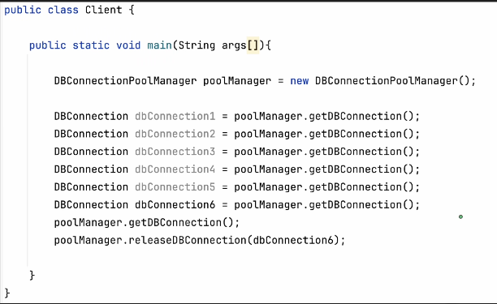
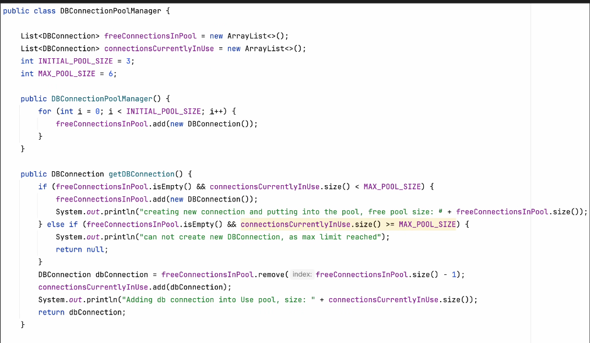
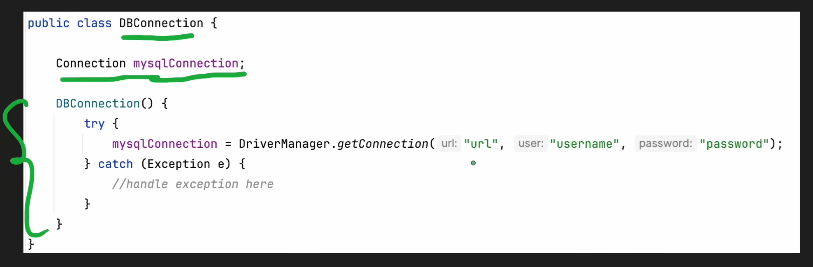

# 3.3.6 Object Pool

| Object Pool Design Pattern | [43. LLD: Object Pool Design Pattern \| Creational Design Pattern \| Low Level Design](<https://www.youtube.com/watch?v=obmc24IHqew>) |
| --- | --- |
|  | https://share.gemini.google/tjjgbLw3j6ef |

Client wants a resource so it will request Resource Pool Manager for it \[**getResource**()\]. Manager will check **freeList** if it has any resource then it will return that resource, and put it in **inUseList, **and after using the resource client will call **releaseResource()** to free the resource.

**Mistake:**

| Client |
| --- |
|  |
| Resource Pool Manager |
|  |
| Resource |
|  |
