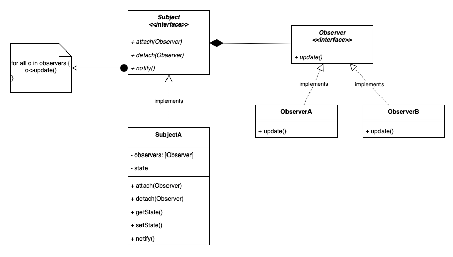

# 3.4.1 Observer

[Most common Use Case of Observer Design Pattern in Low Level Design Interviews](<https://www.youtube.com/watch?v=jEfs2LpmFuo>)

| Observer Design Pattern | [🔥Observer Design patter with Console base app example \| Best Explanation in Hind](<https://www.youtube.com/watch?v=tCFq-Y-U0UQ>)i | [3. Observer Design Pattern Explanation, Walmart Design Interview Question, 2022 \| LLD System Design](<https://www.youtube.com/watch?v=Ep9_Zcgst3U>) | [Observer Design Pattern \| Best Video to Understand \| Low Level Design \| Java \| OOPS](<https://www.youtube.com/watch?v=wFvMUCA0gcg>) | [Observer Design Pattern explained in EASY way with CODE and Real Examples!! ✌️](<https://www.youtube.com/watch?v=gbTWHeGUeXs>) | [Observer Design Pattern](<https://www.youtube.com/watch?v=iLull-LRYO0>) | [Observer Pattern – Design Patterns (ep 2)](<https://www.youtube.com/watch?v=_BpmfnqjgzQ>) | [LLD 11 - Observe Design Pattern in Java \| Zerodha Use Case Explained #codingintelugu #lld #java](<https://www.youtube.com/watch?v=JHuuHe_rMh4>) |
| --- | --- | --- | --- | --- | --- | --- | --- |

[Observer Design Pattern | LLD Series | Low-Level Design with Code & Class Diagram | IPL match code](<https://www.youtube.com/watch?v=QAoFT6J_XiE>)

[Observer Design Pattern | Chapter 13: Low Level Design](<https://www.youtube.com/watch?v=J1crx_xdTuo&list=PLaf8p8Hkzb_F2VUVsYnQUGzGQBrdYtuMr&index=3&pp=iAQB>)

[Observer | Behavioural Design Pattern | Intent, Examples, UML, Code & Trade-Offs](<https://www.youtube.com/watch?v=An8o1TVSRkw&list=PLpVAqPqryuRuiGSz7U7rbYvouCDoM5z_4&index=22&pp=iAQB>)

[Observer Pattern Simplified ](<https://www.youtube.com/watch?v=oCKv6jE62-o&list=PLpxM6m39X_t-Rk9lZVVD4U6JycAAIIEDW&index=12&pp=iAQB>)[👀](<https://www.youtube.com/watch?v=oCKv6jE62-o&list=PLpxM6m39X_t-Rk9lZVVD4U6JycAAIIEDW&index=12&pp=iAQB>)[ | Real-World Examples + Best Practices ](<https://www.youtube.com/watch?v=oCKv6jE62-o&list=PLpxM6m39X_t-Rk9lZVVD4U6JycAAIIEDW&index=12&pp=iAQB>)[📚](<https://www.youtube.com/watch?v=oCKv6jE62-o&list=PLpxM6m39X_t-Rk9lZVVD4U6JycAAIIEDW&index=12&pp=iAQB>)
