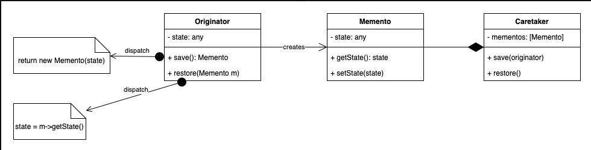

# 3.4.10 Memento

| Memento Design Pattern | [38. Memento Design Pattern explanation \| LLD System Design \| Design pattern explanation in Java](<https://www.youtube.com/watch?v=nTo7e2lpGZ4>) |
| --- | --- |

[Memento Design Pattern in detail \| Interview Question](<https://www.youtube.com/watch?v=JS6H3Zo4_2I&pp=ygUWbWVtZW50byBkZXNpZ24gcGF0dGVybg%3D%3D>)

[Memento \| Behavioural Design Pattern \| Intent, Examples, UML, Code & Trade-Offs](<https://www.youtube.com/watch?v=9KUID3RHuYw&list=PLpVAqPqryuRuiGSz7U7rbYvouCDoM5z_4&index=29&pp=iAQB>)

[Memento Design Pattern Explained: ](<https://www.youtube.com/watch?v=WxKrJFYPK-A&list=PLpxM6m39X_t-Rk9lZVVD4U6JycAAIIEDW&index=20&pp=iAQB0gcJCX4JAYcqIYzv>)[📝](<https://www.youtube.com/watch?v=WxKrJFYPK-A&list=PLpxM6m39X_t-Rk9lZVVD4U6JycAAIIEDW&index=20&pp=iAQB0gcJCX4JAYcqIYzv>)[ Preserve Object State ](<https://www.youtube.com/watch?v=WxKrJFYPK-A&list=PLpxM6m39X_t-Rk9lZVVD4U6JycAAIIEDW&index=20&pp=iAQB0gcJCX4JAYcqIYzv>)[💾](<https://www.youtube.com/watch?v=WxKrJFYPK-A&list=PLpxM6m39X_t-Rk9lZVVD4U6JycAAIIEDW&index=20&pp=iAQB0gcJCX4JAYcqIYzv>)[ & Undo Changes ](<https://www.youtube.com/watch?v=WxKrJFYPK-A&list=PLpxM6m39X_t-Rk9lZVVD4U6JycAAIIEDW&index=20&pp=iAQB0gcJCX4JAYcqIYzv>)[🔄](<https://www.youtube.com/watch?v=WxKrJFYPK-A&list=PLpxM6m39X_t-Rk9lZVVD4U6JycAAIIEDW&index=20&pp=iAQB0gcJCX4JAYcqIYzv>)
