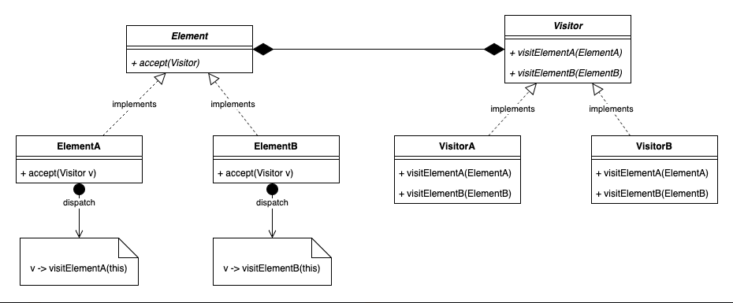

# 3.4.11 Visitor

| Visitor Design Pattern | [36. Visitor Design Pattern \| Double Dispatch \| Low Level Design](<https://www.youtube.com/watch?v=pDsz-AuFO0g>) |
| --- | --- |

[Visitor Pattern in Java and Python](<https://www.youtube.com/watch?v=ZWRibLXyPUc&pp=ygUWdmlzaXRvciBkZXNpZ24gcGF0dGVybg%3D%3D>)

[Visitor \| Behavioural Design Pattern \| Intent, Examples, UML, Code & Trade-Offs](<https://www.youtube.com/watch?v=U_LjSTMW7lo&list=PLpVAqPqryuRuiGSz7U7rbYvouCDoM5z_4&index=30&pp=iAQB>)

[Visitor Design Pattern Explained: ](<https://www.youtube.com/watch?v=MvwkgjHe5Ic&list=PLpxM6m39X_t-Rk9lZVVD4U6JycAAIIEDW&index=19&pp=iAQB>)[👨‍🏫](<https://www.youtube.com/watch?v=MvwkgjHe5Ic&list=PLpxM6m39X_t-Rk9lZVVD4U6JycAAIIEDW&index=19&pp=iAQB>)[ Best Practices ](<https://www.youtube.com/watch?v=MvwkgjHe5Ic&list=PLpxM6m39X_t-Rk9lZVVD4U6JycAAIIEDW&index=19&pp=iAQB>)[✅](<https://www.youtube.com/watch?v=MvwkgjHe5Ic&list=PLpxM6m39X_t-Rk9lZVVD4U6JycAAIIEDW&index=19&pp=iAQB>)[ & Real-World Examples ](<https://www.youtube.com/watch?v=MvwkgjHe5Ic&list=PLpxM6m39X_t-Rk9lZVVD4U6JycAAIIEDW&index=19&pp=iAQB>)[🌍](<https://www.youtube.com/watch?v=MvwkgjHe5Ic&list=PLpxM6m39X_t-Rk9lZVVD4U6JycAAIIEDW&index=19&pp=iAQB>)

