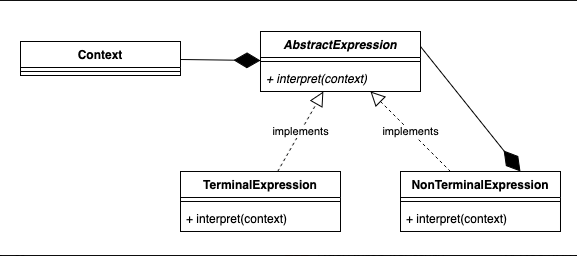

# 3.4.12 Interpreter

| Interpreter Design Pattern | [40. Interpreter Design Pattern \| LLD System Design \| Design pattern explanation in Java](<https://www.youtube.com/watch?v=fFlPm0pzQYI>) |
| --- | --- |

[Interpreter \| Behavioural Design Pattern \| Intent, Examples, UML, Code & Trade-Offs](<https://www.youtube.com/watch?v=8UzjS_SpKLg&list=PLpVAqPqryuRuiGSz7U7rbYvouCDoM5z_4&index=31&pp=iAQB>)

