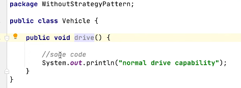
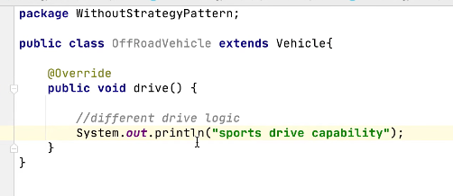
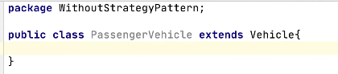
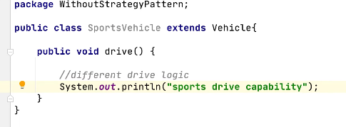
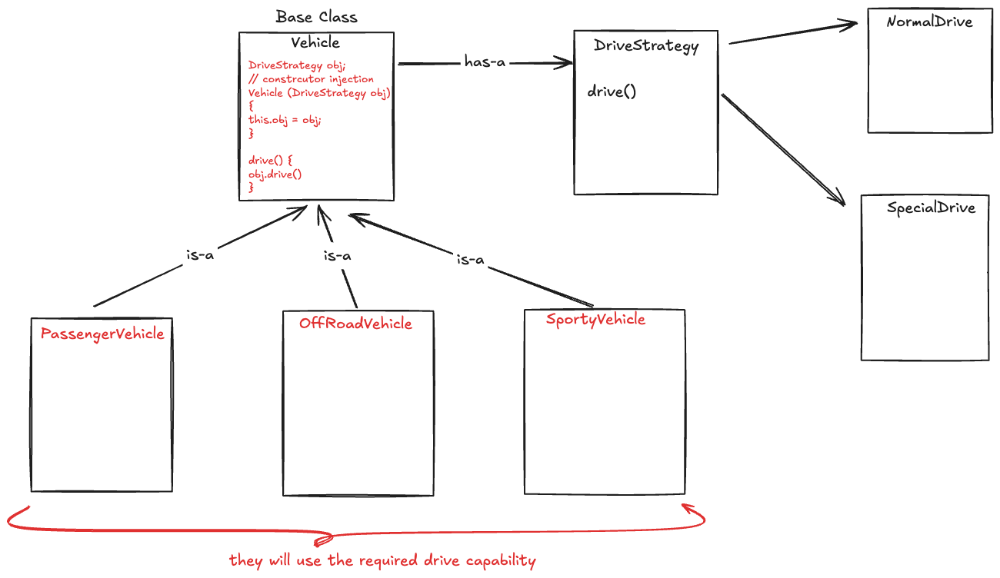
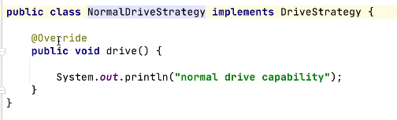
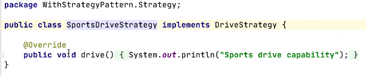
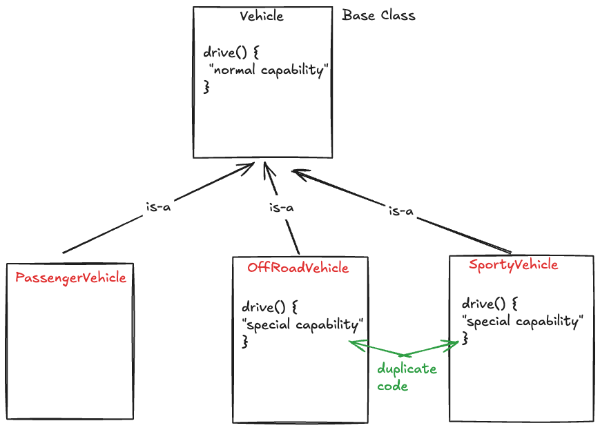

# 3.4.3 Strategy

[Using Strategy Design Pattern to Solve Low Level Design Interview Questions](<https://www.youtube.com/watch?v=iJkWqHw2PJc>)

| Strategy Design Pattern | [Strategy Design Pattern \| Important Behavioral Design Pattern for Interview](<https://www.youtube.com/watch?v=sKKwUdlS0FM>) | [System Design - LLD - Strategy & Adapter Pattern](<https://www.youtube.com/watch?v=FNvIrTyBJfc>) | [LLD 12 - Master Strategy Design Patterns \| Google Maps Routing Example in Java #codingintelugu #java](<https://www.youtube.com/watch?v=ADpOMR6Qcd0>) | [2. Strategy Design Pattern explanation \| LLD System Design #1 \| Design pattern explanation in Jav](<https://www.youtube.com/watch?v=u8DttUrXtEw>)a | [Strategy Design Pattern \| NetFlix Video Player \| Object Oriented Design Pattern Interview Question](<https://www.youtube.com/watch?v=Si3Eln6k7ZA>) | [Strategy Pattern – Design Patterns (ep 1)](<https://www.youtube.com/watch?v=v9ejT8FO-7I>) |
| --- | --- | --- | --- | --- | --- | --- |

[Strategy Design Pattern Explained with Code & Examples \| LLD Series #1 \| Java Language](<https://www.youtube.com/watch?v=Nm1ob7ZjjBM>)

[Strategy \| Behavioural Design Pattern \| Intent, Examples, UML, Code & Trade-Offs](<https://www.youtube.com/watch?v=ALXKlfftItw&list=PLpVAqPqryuRuiGSz7U7rbYvouCDoM5z_4&index=21&pp=iAQB>)

[Strategy Pattern Guide ](<https://www.youtube.com/watch?v=AcY2GWHCe7k&list=PLpxM6m39X_t-Rk9lZVVD4U6JycAAIIEDW&index=11&pp=iAQB>)[⚙️](<https://www.youtube.com/watch?v=AcY2GWHCe7k&list=PLpxM6m39X_t-Rk9lZVVD4U6JycAAIIEDW&index=11&pp=iAQB>)[| Pick the Best Algorithm Dynamically ](<https://www.youtube.com/watch?v=AcY2GWHCe7k&list=PLpxM6m39X_t-Rk9lZVVD4U6JycAAIIEDW&index=11&pp=iAQB>)[🚀](<https://www.youtube.com/watch?v=AcY2GWHCe7k&list=PLpxM6m39X_t-Rk9lZVVD4U6JycAAIIEDW&index=11&pp=iAQB>)

## Strategy Design Pattern

Childs are using duplicate code, which is not present in parent. As system goes, duplicacy increases, so code is not scalable.

Solution:

public interface DriveStrategy {

public void drive();

}

