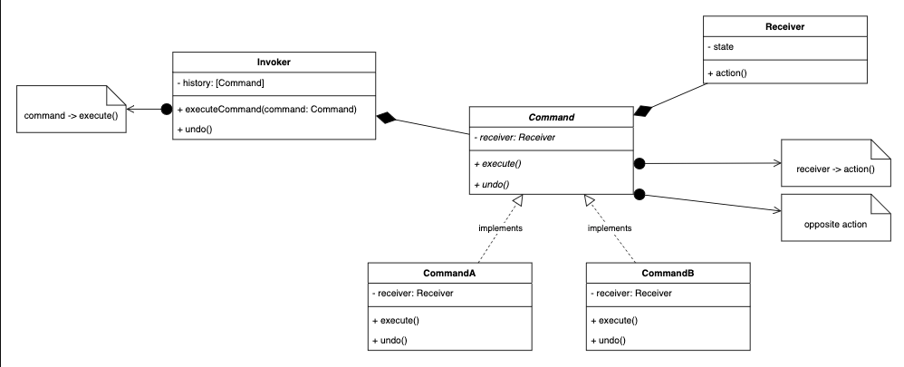

# 3.4.4 Command

| Command Design Pattern | [Command Design Pattern \| Important Behavioral Design Pattern for Java interview](<https://www.youtube.com/watch?v=UbaQrjg1shQ>) | [31. Design Undo, Redo feature with Command Pattern \| Command Design Pattern\| Low Level System Design](<https://www.youtube.com/watch?v=E1lce5CWhE0>) | [Command Pattern – Design Patterns (ep 7)](<https://www.youtube.com/watch?v=9qA5kw8dcSU>) |
| --- | --- | --- | --- |

[Command Design Pattern \| Chapter 14: Low Level Design](<https://www.youtube.com/watch?v=lcuEknFDQ-k&list=PLaf8p8Hkzb_F2VUVsYnQUGzGQBrdYtuMr&index=2&pp=iAQB>)

[🔥](<https://www.youtube.com/watch?v=WZVJz4O6LCY&list=PL76zRLpXzDOGAFvCDSfaF28XL_d-WO08t&index=13&pp=iAQB0gcJCX4JAYcqIYzv>)[ Command Design Pattern in 19 Minutes | Undo+Redo+Macro+Queuing+Logging |  Low Level System Design](<https://www.youtube.com/watch?v=WZVJz4O6LCY&list=PL76zRLpXzDOGAFvCDSfaF28XL_d-WO08t&index=13&pp=iAQB0gcJCX4JAYcqIYzv>)

[Command \| Behavioural Design Pattern \| Intent, Examples, UML, Code & Trade-Offs](<https://www.youtube.com/watch?v=K0eIreDlNOk&list=PLpVAqPqryuRuiGSz7U7rbYvouCDoM5z_4&index=24&pp=iAQB>)

[31. Design Undo, Redo feature with Command Pattern \| Command Design Pattern\| Low Level System Design](<https://www.youtube.com/watch?v=E1lce5CWhE0&list=PL6W8uoQQ2c61X_9e6Net0WdYZidm7zooW&index=35&pp=iAQB>)

[Command Pattern Explained ](<https://www.youtube.com/watch?v=yrD80SnWm5o&list=PLpxM6m39X_t-Rk9lZVVD4U6JycAAIIEDW&index=14&pp=iAQB>)[🧠](<https://www.youtube.com/watch?v=yrD80SnWm5o&list=PLpxM6m39X_t-Rk9lZVVD4U6JycAAIIEDW&index=14&pp=iAQB>)[ |  Structure Actions for Cleaner Code ](<https://www.youtube.com/watch?v=yrD80SnWm5o&list=PLpxM6m39X_t-Rk9lZVVD4U6JycAAIIEDW&index=14&pp=iAQB>)[✅](<https://www.youtube.com/watch?v=yrD80SnWm5o&list=PLpxM6m39X_t-Rk9lZVVD4U6JycAAIIEDW&index=14&pp=iAQB>)
