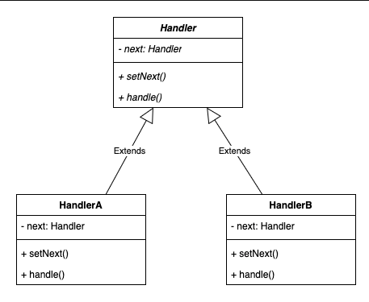

# 3.4.5 Chain of Responsibility

| Chain of Responsibility | [Chain of Responsibility Design pattern \| Important Java interview Question for Behavioral pattern](<https://www.youtube.com/watch?v=prU7d1vetMw>) | [10. Design Logging System \| Chain of Responsibility Design Pattern \| Amazon System Design interview](<https://www.youtube.com/watch?v=gvIn5QBdGDk>) | [Chain Of Responsibility Design Pattern \| Object Oriented Design Pattern \| OOPS Programming](<https://www.youtube.com/watch?v=dKzZcKcPXvM>) | [Chain of responsibility Design pattern part ](<https://www.youtube.com/watch?v=5b7rOqqz_dM>)1 |
| --- | --- | --- | --- | --- |

[Chain of Responsibility | Behavioural Design Pattern | Intent, Examples, UML, Code & Trade-Offs](<https://www.youtube.com/watch?v=Dkki9t9Aex8&list=PLpVAqPqryuRuiGSz7U7rbYvouCDoM5z_4&index=27&pp=iAQB>)

[Chain Of Responsibility Design Pattern | Chapter 15: Low Level Design](<https://www.youtube.com/watch?v=b2ue9Eve_m4&list=PLaf8p8Hkzb_F2VUVsYnQUGzGQBrdYtuMr&index=1&pp=iAQB>)

[Chain of Responsibility Pattern: ](<https://www.youtube.com/watch?v=SYulyXp5zKs&list=PLpxM6m39X_t-Rk9lZVVD4U6JycAAIIEDW&index=18&pp=iAQB0gcJCX4JAYcqIYzv>)[🔗](<https://www.youtube.com/watch?v=SYulyXp5zKs&list=PLpxM6m39X_t-Rk9lZVVD4U6JycAAIIEDW&index=18&pp=iAQB0gcJCX4JAYcqIYzv>)[ Improve Code Flexibility ](<https://www.youtube.com/watch?v=SYulyXp5zKs&list=PLpxM6m39X_t-Rk9lZVVD4U6JycAAIIEDW&index=18&pp=iAQB0gcJCX4JAYcqIYzv>)[♻️](<https://www.youtube.com/watch?v=SYulyXp5zKs&list=PLpxM6m39X_t-Rk9lZVVD4U6JycAAIIEDW&index=18&pp=iAQB0gcJCX4JAYcqIYzv>)[ & Maintainability ](<https://www.youtube.com/watch?v=SYulyXp5zKs&list=PLpxM6m39X_t-Rk9lZVVD4U6JycAAIIEDW&index=18&pp=iAQB0gcJCX4JAYcqIYzv>)[🛠️](<https://www.youtube.com/watch?v=SYulyXp5zKs&list=PLpxM6m39X_t-Rk9lZVVD4U6JycAAIIEDW&index=18&pp=iAQB0gcJCX4JAYcqIYzv>)
