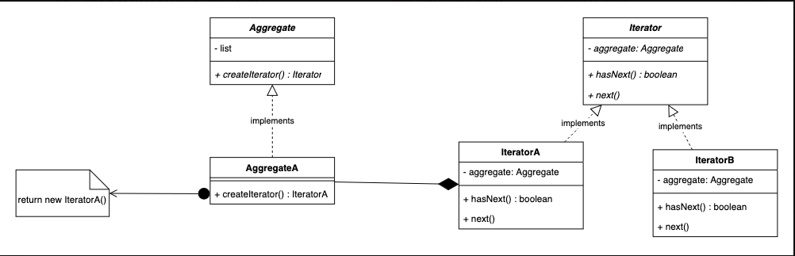

# 3.4.6 Iterator

| Iterator Design Pattern | [🔥Iterator Design Pattern \| How to implement Iterator Design Pattern \| Design Pattern Ser](<https://www.youtube.com/watch?v=YLAwNBHrLOc>)ies | [33. Iterator Design Pattern Explained with Example \| Low Level Design](<https://www.youtube.com/watch?v=X7shKHOaYtU>) | [Iterator Pattern – Design Patterns (ep 16)](<https://www.youtube.com/watch?v=uNTNEfwYXhI>) |
| --- | --- | --- | --- |

[Iterator | Behavioural Design Pattern | Intent, Examples, UML, Code & Trade-Offs](<https://www.youtube.com/watch?v=84DbFZVD3zo&list=PLpVAqPqryuRuiGSz7U7rbYvouCDoM5z_4&index=25&pp=iAQB>)

[Iterator Pattern Tutorial ](<https://www.youtube.com/watch?v=UrxdNL94Xfc&list=PLpxM6m39X_t-Rk9lZVVD4U6JycAAIIEDW&index=13&pp=iAQB0gcJCX4JAYcqIYzv>)[🔄](<https://www.youtube.com/watch?v=UrxdNL94Xfc&list=PLpxM6m39X_t-Rk9lZVVD4U6JycAAIIEDW&index=13&pp=iAQB0gcJCX4JAYcqIYzv>)[ | Iterate Collections Like a Pro ](<https://www.youtube.com/watch?v=UrxdNL94Xfc&list=PLpxM6m39X_t-Rk9lZVVD4U6JycAAIIEDW&index=13&pp=iAQB0gcJCX4JAYcqIYzv>)[⭐](<https://www.youtube.com/watch?v=UrxdNL94Xfc&list=PLpxM6m39X_t-Rk9lZVVD4U6JycAAIIEDW&index=13&pp=iAQB0gcJCX4JAYcqIYzv>)

import java.util.\*;

// A simple Video class with title

class Video {

String title;

public Video(String title) {

this.title = title;

}

public String getTitle() {

return title;

}

}

// YouTubePlaylist class holds a list of Video objects

class YouTubePlaylist {

private List<Video> videos = new ArrayList<>();

// Add a video to the playlist

public void addVideo(Video video) {

videos.add(video);

}

// Expose the video list

public List<Video> getVideos() {

return videos;

}

}

// Client Code

class Main {

public static void main(String\[\] args) {

YouTubePlaylist playlist = new YouTubePlaylist();

playlist.addVideo(new Video("LLD Tutorial"));

playlist.addVideo(new Video("System Design Basics"));

// Loop through videos and print titles

for (Video v : playlist.getVideos()) {

System.out.println(v.getTitle());

}

}

}

import java.util.\*;

// ========== Video class representing a single video ==========

class Video {

private String title;

public Video(String title) {

this.title = title;

}

public String getTitle() {

return title;

}

}

// ================ Playlist interface ================

// (acts as a contract for collections that are iterable)

interface Playlist {

// Method to return an iterator for the collection

PlaylistIterator createIterator();

}

// ========== YouTubePlaylist class (Aggregate) ==========

// Implements Playlist to guarantee it provides an iterator

class YouTubePlaylist implements Playlist {

private List<Video> videos = new ArrayList<>();

// Method to add a video to the playlist

public void addVideo(Video video) {

videos.add(video);

}

// Instead of exposing the list, return an iterator

@Override

public PlaylistIterator createIterator() {

return new YouTubePlaylistIterator(videos);

}

}

// ========== Iterator interface (defines traversal contract) ==========

interface PlaylistIterator {

boolean hasNext();   // Checks if more elements are left

Video next();        // Returns the next element

}

// ========== Concrete Iterator class ==========

// Implements the actual logic for traversing the YouTubePlaylist

class YouTubePlaylistIterator implements PlaylistIterator {

private List<Video> videos;

private int position;

// Constructor takes the collection to iterate over

public YouTubePlaylistIterator(List<Video> videos) {

this.videos = videos;

this.position = 0;

}

// Check if more videos are left

@Override

public boolean hasNext() {

return position < videos.size();

}

// Return the next video in the playlist

@Override

public Video next() {

return hasNext() ? videos.get(position++) : null;

}

}

// ========== Main method (Client code) ==========

public class Main {

public static void main(String\[\] args) {

// Create a playlist and add videos to it

YouTubePlaylist playlist = new YouTubePlaylist();

playlist.addVideo(new Video("LLD Tutorial"));

playlist.addVideo(new Video("System Design Basics"));

// Client simply asks for an iterator — no access to internal data structure

PlaylistIterator iterator = playlist.createIterator();

// Iterate through the playlist using the provided interface

while (iterator.hasNext()) {

System.out.println(iterator.next().getTitle());

}

}

}
