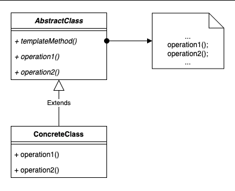

# 3.4.7 Template

| Template Design Pattern | [Template Design Pattern \| Behavioral Design Pattern](<https://www.youtube.com/watch?v=IHAYn-ukXsc>) | [39. Template Method Design Pattern Explanation in Java \| Concept and Coding LLD \| Low Level Design](<https://www.youtube.com/watch?v=kwy-G1DEm0M>) | [Template Method Pattern – Design Patterns (ep 13)](<https://www.youtube.com/watch?v=7ocpwK9uesw>) |
| --- | --- | --- | --- |

[Template Method | Behavioural Design Pattern | Intent, Examples, UML, Code & Trade-Offs](<https://www.youtube.com/watch?v=6hrDxIWO-Vo&list=PLpVAqPqryuRuiGSz7U7rbYvouCDoM5z_4&index=23&pp=iAQB>)

[Template Design Pattern: ](<https://www.youtube.com/watch?v=MjqEq-v3KFo&list=PLpxM6m39X_t-Rk9lZVVD4U6JycAAIIEDW&index=17&pp=iAQB>)[📄](<https://www.youtube.com/watch?v=MjqEq-v3KFo&list=PLpxM6m39X_t-Rk9lZVVD4U6JycAAIIEDW&index=17&pp=iAQB>)[ Simplifying Code Reusability ](<https://www.youtube.com/watch?v=MjqEq-v3KFo&list=PLpxM6m39X_t-Rk9lZVVD4U6JycAAIIEDW&index=17&pp=iAQB>)[🔄](<https://www.youtube.com/watch?v=MjqEq-v3KFo&list=PLpxM6m39X_t-Rk9lZVVD4U6JycAAIIEDW&index=17&pp=iAQB>)[ with Examples ](<https://www.youtube.com/watch?v=MjqEq-v3KFo&list=PLpxM6m39X_t-Rk9lZVVD4U6JycAAIIEDW&index=17&pp=iAQB>)[💡](<https://www.youtube.com/watch?v=MjqEq-v3KFo&list=PLpxM6m39X_t-Rk9lZVVD4U6JycAAIIEDW&index=17&pp=iAQB>)
