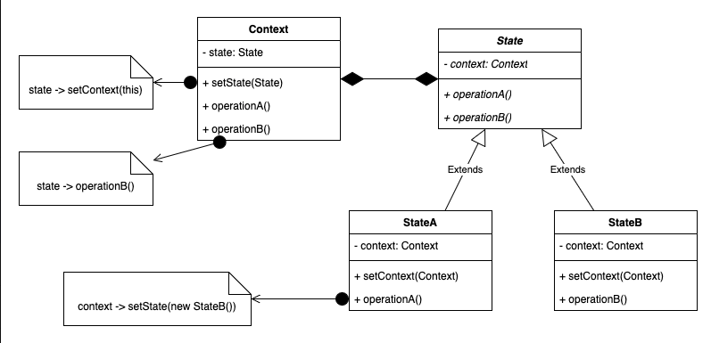

# 3.4.8 State

[Using State Design Pattern to simplify complex use cases during Low Level Design Interviews](<https://www.youtube.com/watch?v=HRnq_aeMraM>)

| State Design Pattern | [State Pattern – Design Patterns (ep 17)](<https://www.youtube.com/watch?v=N12L5D78MAA>) |
| --- | --- |

[State | Behavioural Design Pattern | Intent, Examples, UML, Code & Trade-Offs](<https://www.youtube.com/watch?v=eOjs6qfx2-c&list=PLpVAqPqryuRuiGSz7U7rbYvouCDoM5z_4&index=26&pp=iAQB>)

[State Design Pattern: ](<https://www.youtube.com/watch?v=uQMiEP52YIg&list=PLpxM6m39X_t-Rk9lZVVD4U6JycAAIIEDW&index=16&pp=iAQB0gcJCX4JAYcqIYzv>)[🔄](<https://www.youtube.com/watch?v=uQMiEP52YIg&list=PLpxM6m39X_t-Rk9lZVVD4U6JycAAIIEDW&index=16&pp=iAQB0gcJCX4JAYcqIYzv>)[ Manage Object Behavior Dynamically ](<https://www.youtube.com/watch?v=uQMiEP52YIg&list=PLpxM6m39X_t-Rk9lZVVD4U6JycAAIIEDW&index=16&pp=iAQB0gcJCX4JAYcqIYzv>)[⚙️](<https://www.youtube.com/watch?v=uQMiEP52YIg&list=PLpxM6m39X_t-Rk9lZVVD4U6JycAAIIEDW&index=16&pp=iAQB0gcJCX4JAYcqIYzv>)
