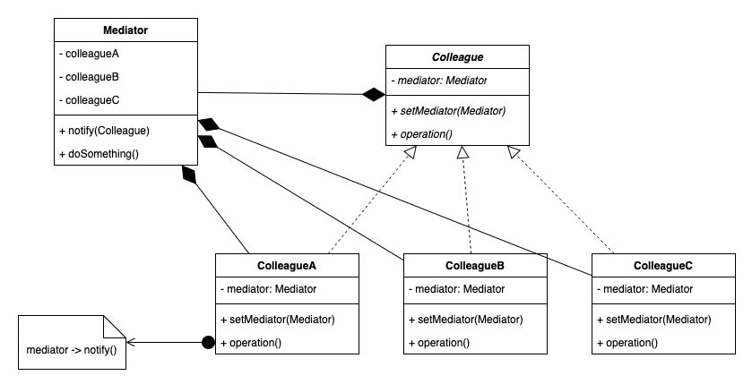

# 3.4.9 Mediator

| Mediator Design Pattern | [The Ultimate Guide to Mediator Design Pattern](<https://www.youtube.com/watch?v=IBOEaIvQ7Rk>) | [34. Design Online Auction System with Mediator Design Pattern \| Low Level System Design](<https://www.youtube.com/watch?v=bKM2lFPPmmY>) |
| --- | --- | --- |

[Mediator \| Behavioural Design Pattern \| Intent, Examples, UML, Code & Trade-Offs](<https://www.youtube.com/watch?v=CN236Qc7DwE&list=PLpVAqPqryuRuiGSz7U7rbYvouCDoM5z_4&index=28&pp=iAQB>)

[Mediator Design Pattern: ](<https://www.youtube.com/watch?v=hq0bTdBfc84&list=PLpxM6m39X_t-Rk9lZVVD4U6JycAAIIEDW&index=15&pp=iAQB>)[🏗️](<https://www.youtube.com/watch?v=hq0bTdBfc84&list=PLpxM6m39X_t-Rk9lZVVD4U6JycAAIIEDW&index=15&pp=iAQB>)[ Reduce Complexity & ](<https://www.youtube.com/watch?v=hq0bTdBfc84&list=PLpxM6m39X_t-Rk9lZVVD4U6JycAAIIEDW&index=15&pp=iAQB>)[🔄](<https://www.youtube.com/watch?v=hq0bTdBfc84&list=PLpxM6m39X_t-Rk9lZVVD4U6JycAAIIEDW&index=15&pp=iAQB>)[ Improve Communication Between Objects ](<https://www.youtube.com/watch?v=hq0bTdBfc84&list=PLpxM6m39X_t-Rk9lZVVD4U6JycAAIIEDW&index=15&pp=iAQB>)[🧩](<https://www.youtube.com/watch?v=hq0bTdBfc84&list=PLpxM6m39X_t-Rk9lZVVD4U6JycAAIIEDW&index=15&pp=iAQB>)
