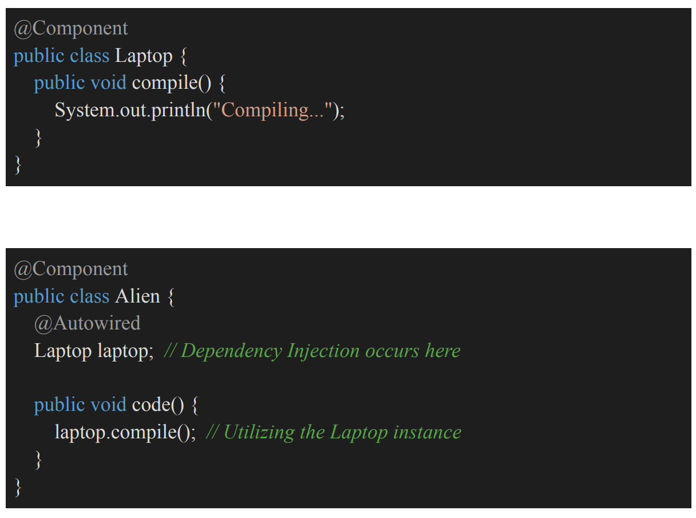

# 3.5.3 Dependency Injection

DI - Dependency Injection

  - Design pattern used to inject objects into our application, implementing the IoC principle

  - DI is a specific implementation of IoC that involves providing an object's dependencies from an external source rather than having the object create them internally. This fosters loose coupling between classes and enhances testability and maintainability.

  - LaptopObj and AlienObj are available in the IOC container, but how can we inject LaptopObj in AlienObj

class OrderService {

private InventoryService inventory = new InventoryService();

private PaymentService payment = new RazorpayPayment();

private NotificationService notification = new NotificationService();

public void checkout(Order order) {

inventory.blockItems(order);

payment.process(order);

notification.sendConfirmation(order);

}

}

import java.util.\*;

class OrderService2 {

private InventoryService inventory;

private PaymentService payment;

private NotificationService notification;

// Constructor Injection - Dependencies are injected through the constructor

public OrderService2(InventoryService inventory,

PaymentService payment,

NotificationService notification) {

this.inventory = inventory;

this.payment = payment;

this.notification = notification;

}

public void checkout(Order order) {

inventory.blockItems(order);

payment.process(order);

notification.sendConfirmation(order);

}

}

// Client-side code

class Main {

public static void main(String\[\] args) {

// Injecting dependencies manually (Constructor Injection)

OrderService2 orderService2 = new OrderService2(

new InventoryService(),

new RazorpayPayment(),

new NotificationService()

);

// Now, we can use the orderService2 to perform operations

orderService2.checkout(order);

}

}

// Using Constructor Injection

public class OrderService {

private final PaymentService payment;

// Constructor

public OrderService(PaymentService payment) {

this.payment = payment;

}

public void checkout(Order order) {

payment.process(order);

}

}

// Using Setter Injection

public class OrderService {

private PaymentService payment;

// Setter method to inject dependencies

public void setPayment(PaymentService payment) {

this.payment = payment;

}

public void checkout(Order order) {

payment.process(order);

}

}

// Interface to inject PaymentService dependency

public interface PaymentInjectable {

// Method to inject PaymentService

void injectPayment(PaymentService payment);

}

// Using Interface Injection

public class OrderService implements PaymentInjectable {

private PaymentService payment;

// Inject PaymentService through the method

@Override

public void injectPayment(PaymentService payment) {

this.payment = payment; // Set the injected payment service

}

public void checkout(Order order) {

payment.process(order);

}

}

// ── Contract: defines what the client needs, not how it is done

interface NotificationService {

void send(String message);

}

// ── Concrete implementation of the contract

class EmailNotificationService implements NotificationService {

@Override

public void send(String message) {

System.out.println("Email sent: " + message);

}

}

// ── Client that depends on the abstraction, not the implementation

class UserService {

// Dependency held as an interface, promoting loose coupling

private final NotificationService notificationService;

// Constructor Injection: forces the caller to supply the dependency up-front

public UserService(NotificationService notificationService) {

this.notificationService = notificationService;

}

// Business logic uses the injected service

public void register(String user) {

System.out.println("User registered: " + user);

notificationService.send("Welcome " + user);

}

}

// ── Composition Root: the only place where “new” keywords appear

class Main {

public static void main(String\[\] args) {

// Create the concrete dependency

NotificationService service = new EmailNotificationService();

// Inject it into the client

UserService userService = new UserService(service);

// Execute business operation

userService.register("raj");

}

}

| **Symptom** | **Fix with DI** |
| --- | --- |
| Classes use new for internal collaborators | Constructor Injection |
| Cannot mock services in tests | Inject dependency via interface |
| Adding feature breaks old code | Use abstraction and inject |
| Too many **if** / **switch** for service type | Inject strategy implementation |
