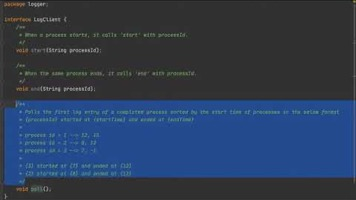
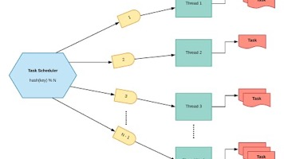

# 4.15 Logger

[Google low level system design question - Part 1 - Implement a logger](<https://www.youtube.com/watch?v=FKA2KgkkcqY>)

[Low level System Design of a Logger Part 2: Solving for concurrency and locking](<https://www.youtube.com/live/bPkXQszkkpY?si=q-gT9rrTsthpWRKy>)

