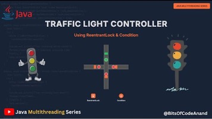

# 4.21 Traffic Light Two Roads Intersection

https://algo.monster/liteproblems/1279

https://enginebogie.com/public/question/traffic-light-controller-for-a-two-road-intersection/1831?srsltid=AfmBOop5wYDUd1BT5zeIPTo2xQel5QONxewBW6x_15dg7lEh-YvjcEge

[#12 ](<https://www.youtube.com/watch?v=ApxXbT2WynE>)[🚦](<https://www.youtube.com/watch?v=ApxXbT2WynE>)[Traffic Light Controller Problem using Threads | Java Multithreading](<https://www.youtube.com/watch?v=ApxXbT2WynE>)

